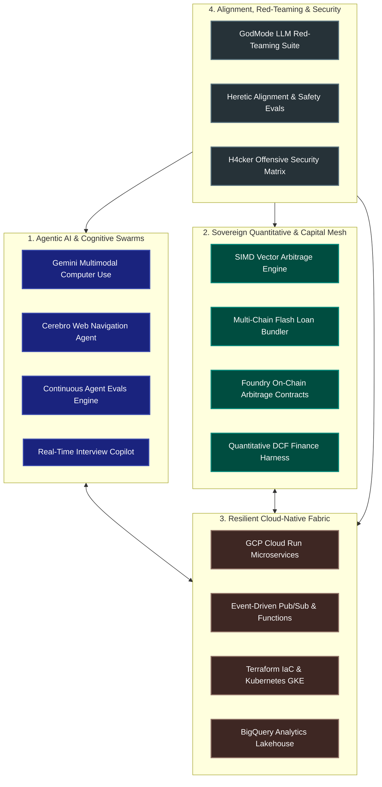

<div align="center">

# 🌌 OMNIVERSO DIGITAL
### Autonomous Intelligence · Sovereign Systems Architecture · Cloud-Native Infrastructure

[](https://github.com/omniversodigital)
[](https://omniverso.digital)
[](https://github.com/omniversodigital)
[](https://github.com/omniversodigital/h4cker)

<br/>

```
      ___           ___           ___           ___           ___     
     /\  \         /\__\         /\__\         /\__\         /\  \    
    /::\  \       /::|  |       /:/  /        /::|  |       /::\  \   
   /:/\:\  \     /:|:|  |      /:/  /        /:|:|  |      /:/\:\  \  
  /:/  \:\  \   /:/|:|__|__   /:/  /  ___   /:/|:|__|__   /::\~\:\  \ 
 /:/__/ \:\__\ /:/ |::::\__\ /:/__/  /\__\ /:/ |::::\__\ /:/\:\ \:\__\
 \:\  \ /:/  / \/__/~~/:/  / \:\  \ /:/  / \/__/~~/:/  / \/_|::\/:/  /
  \:\  /:/  /        /:/  /   \:\  /:/  /        /:/  /     |:|::/  / 
   \:\/:/  /        /:/  /     \:\/:/  /        /:/  /      |:|\/__/  
    \::/  /        /:/  /       \::/  /        /:/  /       |:|  |    
     \/__/         \/__/         \/__/         \/__/         \|__|    
                         D  I  G  I  T  A  L
```

<p align="center">
  <b>Architecting the frontier of autonomous agent swarms, sub-150µs quantitative arbitrage, and self-healing cloud infrastructure.</b>
</p>

[🌐 Official Portal](https://omniverso.digital) • [💼 LinkedIn](https://www.linkedin.com/in/jeancarlo-ferreira) • [📫 Contact Engineering](mailto:omniversodigital@gmail.com)

---

</div>

## 🏛️ System Architecture Topology

The Omniverso Digital platform is structured around four decoupled, self-orchestrating sovereign layers:



---

## ⚡ Flagship Core Ecosystem

| Repository | Focus & Domain | Tech Stack | Status |
| :--- | :--- | :--- | :---: |
| [**`agent-evals-engine`**](https://github.com/omniversodigital/agent-evals-engine) | Continuous LLM evaluation & regression suite for conversational agents | Python 3.12 · PyTest · JSONSchema · GitHub Actions | [](https://github.com/omniversodigital/agent-evals-engine) |
| [**`cerebro-gcp-ecosystem`**](https://github.com/omniversodigital/cerebro-gcp-ecosystem) | Cloud-Native GCP architecture with Cloud Run, Pub/Sub & BigQuery | GCP · Terraform · Docker · Express · BigQuery | [](https://github.com/omniversodigital/cerebro-gcp-ecosystem) |
| [**`omniverso-infra`**](https://github.com/omniversodigital/omniverso-infra) | Zero-trust Terraform IaC and Kubernetes GKE cloud orchestration | Terraform >=1.5 · Kubernetes · Cloud SQL · VPC NAT | [](https://github.com/omniversodigital/omniverso-infra) |
| [**`sovereign-revenue-engine`**](https://github.com/omniversodigital/sovereign-revenue-engine) | On-chain multi-DEX flash arbitrage + 35 Apex modules & FastAPI routers | Foundry · Solidity 0.8 · FastAPI · SIMD · Web3.py | [](https://github.com/omniversodigital/sovereign-revenue-engine) |
| [**`interview-copilot`**](https://github.com/omniversodigital/interview-copilot) | Low-latency speech-to-text context evaluation and coding assistance | Python · Whisper/STT · FastAPI · Streaming WebSockets | [](https://github.com/omniversodigital/interview-copilot) |
| [**`cerebro-web-agent`**](https://github.com/omniversodigital/cerebro-web-agent) | Autonomous browser operator with Qdrant vector memory and n8n | Playwright · Qdrant · Python · n8n Webhooks | [](https://github.com/omniversodigital/cerebro-web-agent) |
| [**`gemini-computer-use`**](https://github.com/omniversodigital/gemini-computer-use) | Multimodal desktop and OS automation via Gemini API | Gemini Multimodal API · Python · PyAutoGUI · PIL | [](https://github.com/omniversodigital/gemini-computer-use) |
| [**`finance-harness`**](https://github.com/omniversodigital/finance-harness) | Quantitative finance evaluation and DCF valuation harness for LLMs | Python · UV · Financial Ratios · Statistical Modeling | [](https://github.com/omniversodigital/finance-harness) |
| [**`godmode-ai`**](https://github.com/omniversodigital/godmode-ai) | Autonomous AI red-teaming and jailbreak vulnerability evaluation | Next.js 14 · React 19 · TypeScript · TailwindCSS | [](https://github.com/omniversodigital/godmode-ai) |
| [**`crypto-dashboard`**](https://github.com/omniversodigital/crypto-dashboard) | High-performance institutional crypto portfolio analytics | React 19 · Vite · TypeScript · Tailwind · Lucide | [](https://github.com/omniversodigital/crypto-dashboard) |
| [**`nexus-research-suite`**](https://github.com/omniversodigital/nexus-research-suite) | Unified multimodal reasoning, biomedical knowledge graphs & privacy evals | Python 3.12 · PyTest · Know2BIO · LogicVista · PrivacyMind | [](https://github.com/omniversodigital/nexus-research-suite) |

---

## 🛠️ Technology Stack & Core Competencies

<div align="center">

| Domain | Technologies & Frameworks |
| :--- | :--- |
| **Languages** | `Python 3.12` • `TypeScript` • `Solidity` • `Go` • `Rust` • `C++` • `SQL / SQLX` • `Bash / PowerShell` |
| **Cloud & DevOps** | `Google Cloud Platform (GCP)` • `Kubernetes (GKE)` • `Terraform` • `Docker` • `Cloud Run` • `Pub/Sub` • `BigQuery` |
| **AI & LLM Frameworks** | `Gemini 2.5` • `Anthropic Claude` • `OpenAI` • `Qdrant` • `LangChain` • `DSPy` • `Whisper STT` • `LiteRT / Gemma` |
| **Web3 & Quant Finance** | `Foundry` • `Aave V3` • `Uniswap V3` • `Flashbots MEV` • `ERC-4337 Account Abstraction` • `SIMD Vectors` |
| **Observability & SRE** | `Prometheus` • `OpenTelemetry` • `Grafana` • `Cloud Monitoring` • `Cloud Logging` • `SQLite WAL` |

</div>

---

## 👨‍💻 Engineering Leadership

<table width="100%">
  <tr>
    <td width="70%">
      <h3>Jean Carlo Ferreira</h3>
      <p><b>Principal Systems Architect & Lead AI Engineer</b></p>
      <ul>
        <li>🎓 <b>Degree:</b> Licenciatura em Engenharia Informática, UNERG (Graduated July 2007)</li>
        <li>⏳ <b>Experience:</b> 17+ years architecting enterprise distributed software, mission-critical systems, and autonomous agent infrastructure.</li>
        <li>📍 <b>Location:</b> Ribeira Brava, Madeira Island, Portugal 🇵🇹</li>
        <li>🌐 <b>Portfolio:</b> <a href="https://omniverso.digital">omniverso.digital</a></li>
        <li>💼 <b>LinkedIn:</b> <a href="https://www.linkedin.com/in/jeancarlo-ferreira">linkedin.com/in/jeancarlo-ferreira</a></li>
        <li>📫 <b>Email:</b> <a href="mailto:jeancarlof@gmail.com">jeancarlof@gmail.com</a> / <a href="mailto:omniversodigital@gmail.com">omniversodigital@gmail.com</a></li>
      </ul>
    </td>
    <td width="30%" align="center">
      
      <br/><br/>
      
    </td>
  </tr>
</table>

---

<div align="center">
  <sub>© 2026 Omniverso Digital. Built with precision, sovereignty, and uncompromising engineering discipline.</sub>
</div>
